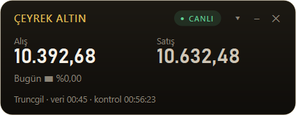
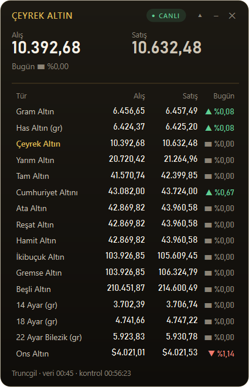

# Çeyrek Takip

Altın fiyatlarını (çeyrek, gram, yarım, tam, cumhuriyet, ata, reşat, beşli, ons ve
daha fazlası) masaüstünde gösteren hafif bir Windows widget'ı. Çerçevesiz, sürüklenebilir
ve sistem tepsisinde çalışır.

<p>
  
  &nbsp;
  
</p>

## Özellikler

- **Öne çıkan altın:** Seçtiğin türün alış/satış fiyatı ve günlük değişimi büyük puntoyla görünür.
- **Tüm altınlar listesi:** `▾` düğmesiyle açılır. Bir satıra tıklayınca o tür öne çıkar.
- **İki veri kaynağı ve otomatik yedekleme:** Seçili kaynak yanıt vermezse diğeri denenir.
- **Dürüst durum göstergesi:** `CANLI` (son istek başarılı), `GECİKMELİ` (elde güncel olmayan veri var),
  `BAĞLANTI YOK`. Alt satırda kaynak, verinin kaynaktaki zamanı ve son kontrol saati yer alır.
- **Fiyat yönü renkleri:** Bir önceki güncellemeye göre artış yeşil, düşüş kırmızı gösterilir.
- **Kalıcı ayarlar:** Kaynak, yenileme aralığı, öne çıkan tür, listede görünen türler,
  ekrana sabitleme ve pencere konumu saklanır.
- **Hızlı açılış:** Son alınan veri saklanır; uygulama açılır açılmaz `GECİKMELİ` etiketiyle gösterilir.
- **Tek kopya:** Uygulama ikinci kez açılmaya çalışılırsa uyarı verir.
- Hatalarda kademeli yeniden deneme (10 sn → 20 sn → 40 sn … en fazla yenileme aralığı kadar).

Tüm ayarlara widget'a **sağ tıklayarak** ya da **tepsi ikonuna sağ tıklayarak** ulaşılır.

## Veri kaynakları

| Kaynak | Güncelleme | Günlük değişim | Not |
| --- | --- | --- | --- |
| [Truncgil Finans](https://finans.truncgil.com/) `v3` (varsayılan) | ~15 dakikada bir | Var | Ücretsiz, anahtarsız geliştirici API'si |
| Altınkaynak | Saniyeler içinde | Yok | Sitesinin kullandığı açık JSON; resmi API değil |

Truncgil'in `today.json` ve `v4` uç noktaları yanıtı sık sık yarıda kesiyor; bu yüzden `v3`
kullanılıyor ve bozuk yanıtlar otomatik olarak yeniden isteniyor.

Varsayılan yenileme aralığı **1 dakika**dır (menüden 30 sn ile 15 dk arasında seçilebilir).
Kaynakların kendi güncelleme hızı bundan yavaşsa, ekranda verinin kaynaktaki zamanı ayrıca gösterilir.

## Kurulum ve çalıştırma

Python 3.11 veya üstü gerekir.

```bash
python -m venv .venv
.venv\Scripts\activate
pip install -e ".[dev]"
ceyrek-takip            # ya da: python -m ceyrek_tracker / python main.py
```

## Geliştirme

```bash
python -m pytest -q          # testler (Qt testleri ekransız çalışır)
python -m ruff check .       # lint
python -m ruff format .      # biçimlendirme
python -m PyInstaller --noconfirm CeyrekTakip.spec   # dist\CeyrekTakip.exe
```

GitHub Actions her push ve PR'da lint ve testleri çalıştırır, ardından exe'yi derleyip
artifact olarak yükler.

## Mimari

```text
src/ceyrek_tracker/
├── app.py               # Giriş noktası + AppController (bileşenleri bağlar)
├── domain/              # Saf Python: katalog, veri modelleri, Türkçe sayı biçimi
├── providers/           # Truncgil, Altınkaynak ve kaynaklar arası yedekleme zinciri
├── services/            # PriceService: zamanlayıcı, yeniden deneme, durum (Qt)
├── ui/                  # Widget penceresi, bileşenler, menü, tema
├── settings.py          # Ayar modeli + doğrulama
├── storage.py           # Atomik JSON yazma, son veri önbelleği
├── paths.py             # %APPDATA%\CeyrekTakip altındaki dosyalar
└── logging_setup.py     # Dönen log dosyası
```

- **Thread modeli:** Zamanlayıcı ana thread'de çalışır. Ağ isteği, `moveToThread` ile ayrı bir
  QThread'e taşınmış worker'da yapılır, bu yüzden arayüz hiç donmaz. Thread'ler arasında yalnızca
  sinyaller ve değişmez nesneler dolaşır.
- **Bağımlılık yönü:** `ui` → `services` → `providers` → `domain`. `domain` Qt'ye bağlı değildir
  ve tamamen birim testlerle kapsanır.
- **Yeni kaynak eklemek:** `providers/` altına `fetch() -> Snapshot` yöntemi olan bir sınıf yaz,
  katalog id'lerine eşle, `providers/__init__.py` içindeki `PROVIDER_CHOICES` ve
  `create_providers` listelerine ekle.

## İkon

`src/ceyrek_tracker/assets/icon.ico`, `tools/make_icon.py` betiğinin çıktısıdır. İkonu değiştirmek
için betiği düzenleyip `python tools/make_icon.py` ile yeniden üretin.

## Kullanıcı verisi

`%APPDATA%\CeyrekTakip\` klasöründe tutulur:

- `settings.json`: ayarlar
- `last_snapshot.json`: son alınan fiyatlar
- `logs\app.log`: loglar (sorun bildirirken bu dosyayı ekleyin)
