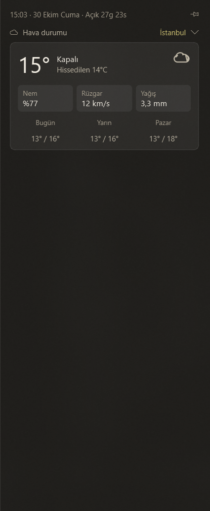

# Çeyrek Takip

Ekranın sağ kenarından kayarak açılan, modüler bir Windows durum paneli. Her bilgi
(hava durumu, sistem, piyasa, müzik...) bağımsız bir **kart**tır; kartlar açılıp
kapanabilir, katlanabilir ve sıralanabilir.

<p>
  
</p>

> Proje geliştirme aşamasında. Şu an panel iskeleti, tema katmanı, üst bilgi satırı ve
> **hava durumu**, **finans** (döviz, altın, gümüş) ve **Spotify** kartları çalışıyor.
> Sistem, takvim, pil/ses ve pano kartları sırayla eklenecek.

## Kullanım

- **Açmak:** sağ kenardaki ince tutamacın üzerine gel (varsayılan 200 ms bekler) ya da
  tıkla. `Win+Alt+P` kısayolu ve tepsi ikonu da paneli açıp kapatır.
- **Kapatmak:** panelin dışına tıkla ya da fareyi panelden 3 sn uzak tut. Kısayol ve tepsi
  ikonu her zaman kapatır.
- **Sabitlemek:** üst satırdaki iğne düğmesi paneli açık tutar; dışarı tıklama ve fare
  ayrılması kapatmaz. Durum hatırlanır.
- **Katlamak:** kart başlığına tıkla; durum hatırlanır.

## Ayarlar

Tek dosya: `%APPDATA%\CeyrekTakip\settings.json` (uygulama kapalıyken düzenle; hatalı
değerler sessizce varsayılana döner). Ayarlar ekranı sonraki aşamada gelecek.

| Alan | Anlamı |
| --- | --- |
| `open_mode` | `hover` (üzerine gelince) ya da `click` (yalnızca tıklayınca) |
| `hover_delay_ms`, `leave_close_seconds` | Açılış gecikmesi, fare ayrılınca kapanma süresi (0 = kapalı) |
| `hotkey`, `hotkey_screen` | Kısayol (boş = yok) ve hangi ekranda açılacağı (`cursor` / `primary`) |
| `trigger_screen` | Tutamacın ekranı: `primary` ya da ekran adı (ör. `\\.\DISPLAY2`) |
| `handle_thickness`, `handle_length`, `handle_position` | Tutamacın boyutu ve dikey konumu (0 üst, 1 alt) |
| `theme`, `accent`, `density`, `font_scale` | `dark`/`light`, `#rrggbb` vurgu, `compact`/`normal`/`relaxed`, yazı ölçeği |
| `glass_opacity`, `animations`, `animation_ms` | Panel zemininin opaklığı (0,3–1; varsayılan 0,92, düşürdükçe arkadaki pencereler daha çok görünür) ve animasyonlar |
| `cards` | Her kart için `enabled`, `collapsed` ve `config` (ör. hava için `{"city": "Ankara"}`, finans için `{"items": ["usd", "eur", "ceyrek"]}`) |

`Win+Alt+W` gibi bazı kısayollar başka uygulamalarca tutulmuş olabilir; kayıt başarısız
olursa tepsiden uyarı gelir ve `hotkey` değiştirilebilir.

### Finans kartı

Dolar, euro, sterlin, gram altın, çeyrek altın, gümüş ve ons satış fiyatlarını (ve
günlük değişimi) yalnızca yazı olarak gösterir. Veri, panel açıkken dakikada bir
Truncgil'den çekilir; ulaşılamazsa Altınkaynak denenir. Başlıktaki bilgi normalde boştur;
yalnızca yedek kaynak devredeyse kaynağın adı (fiyatlar kaynağa göre değişir), veri 15
dakikadan eskiyse (hafta sonu, kapalı piyasa) saati, güncelleme başarısızsa "eski veri"
notu yazar.

Gösterilecek satırlar `cards` içindeki `finance` ayarında `items` ile seçilir (sıra
korunur): `usd`, `eur`, `gbp`, `chf`, `gram`, `gram_has`, `ceyrek`, `yarim`, `tam`,
`cumhuriyet`, `ata`, `resat`, `hamit`, `ikibucuk`, `gremse`, `besli`, `ayar14`, `ayar18`,
`bilezik22`, `ons`, `gumus`. Altınkaynak'ta karşılığı olmayan satırlar (ör. `cumhuriyet`)
o kaynağa düşülünce `—` görünür.

### Spotify kartı

Spotify masaüstü uygulamasında çalan şarkıyı gösterir ve yönetir: kapak, şarkı, sanatçı,
ilerleme çubuğu (istediğin yere tıklayıp atlanır), önceki / oynat-duraklat /
sonraki, karıştır, tekrarla, ses düzeyi ve ses çıkışı. Hesap bağlamak gerekmez; veri
Windows'un medya oturumundan gelir, bu yüzden yalnızca Spotify'ı izler (tarayıcı
sekmelerini ya da başka çalarları değil) ve Premium şartı yoktur. Panel açıkken saniyede
bir okunur.

- **Spotify kapalıyken** en son kalan şarkı (kapağı ve konumuyla) görünür; uygulama
  Spotify kapalıyken açılsa da böyle olur. Oynat/atla düğmeleri pasifleşir; Spotify açılınca
  güncel şarkı gelir.
- **Kapak** yalnızca albüm görselidir; Spotify'ın görsele eklediği logo bandı kırpılır.
- **Renkler kapağı izler:** kartın arka planındaki yumuşak ışık kapağın baskın tonunu yansıtır;
  şarkı çubuğu, açık karıştır/tekrarla düğmeleri ve oynat dolgusu da aynı tonu alır. Renk,
  algısal OKLCH uzayında seçilir: siyah, beyaz ve gri alanlar oy kullanmaz, her kapakta ışıma
  eşit güçte görünür, çubuk gerçek zemininde okunur kalır. Gri kapağa renk uydurulmaz. Kapak
  yoksa temanın vurgu rengi (altın) kalır.
- **Arka plan panele oturur:** kartın ayrı bir açık yüzeyi yoktur, panelin zemini doğrudan
  görünür. Üzerine, kapaktan uzaklaştıkça irileşen dalgalı bir nokta deseni çok hafifçe biner.
- **Oynat düğmesi** çalarken sade (yalnızca duraklat simgesi), duraklayınca soluk dolgulu
  görünür.
- **Katlıyken** başlık satırında "Sanatçı – Şarkı" özeti görünür.
- **Ses çubuğu** Windows'un sistem sesini (görev çubuğundaki hoparlör) ayarlar; Spotify
  kapalıyken de çalışır. Spotify'ın uygulama içi ses çubuğu dışarıdan ayarlanamaz.
- **Çıkış cihazı** düğmesi, bağlı hoparlör ve kulaklıkları listeler; seçilen, Windows'un
  **varsayılan** çıkışı olur (yalnızca Spotify'ı değil tüm sistemi etkiler).
- Reklam sırasında Spotify atlamayı ve şarkı geçmeyi kapatır; düğmeler de pasif görünür.

## Kurulum ve çalıştırma

Python 3.11 veya üstü gerekir.

```bash
python -m venv .venv
.venv\Scripts\activate
pip install -e ".[dev]"
ceyrek-takip            # ya da: python -m ceyrek_tracker / python main.py
```

## Geliştirme

```bash
python -m pytest -q          # testler (Qt testleri ekransız çalışır)
python -m ruff check .       # lint
python -m ruff format .      # biçimlendirme
python -m PyInstaller --noconfirm CeyrekTakip.spec   # dist\CeyrekTakip.exe
```

## Mimari

Bağımlılık yalnızca aşağıya doğru akar; kurallar `tests/test_architecture.py` ile her test
çalışmasında denetlenir.

```text
app  ->  cards/<özellik>  ->  core  ->  infra, theme
```

```text
src/ceyrek_tracker/
├── app.py            # birleştirme noktası: AppController + giriş noktası (her şeyi bilen tek yer)
├── core/             # panel iskeleti; hiçbir karta bağımlı değil
│   ├── settings.py       # ayarlar (settings.json) ve görünüm üretimi
│   ├── panel_window.py   # çerçevesiz yüzen panel, kayma animasyonu
│   ├── panel_surface.py  # yarı saydam, yuvarlak köşeli, dokulu panel zemini (Qt ile çizilir)
│   ├── card_base.py · card_host.py · card_manager.py   # kart arayüzü, çerçevesi, yaşam döngüsü
│   ├── auto_close.py     # dışarı tıklama / fare uzaklaşması kararı (fare ve saat enjekte edilir)
│   ├── tray.py · header.py · polling.py · widgets.py · screens.py · turkish.py
│   ├── trigger/          # tetikleyici arayüzü + tutamaç (kolay değişir)
│   └── platform/         # Windows'a özgü: hotkey, single_instance, mouse, appid
├── cards/            # her kart kendi paketi; kartlar birbirini bilmez
│   ├── __init__.py       # kart kayıt defteri (CARDS)
│   ├── weather/          # card · api · cache · places · icon · backdrop
│   ├── finance/          # card · catalog · models · providers · service · cache · formatting
│   └── spotify/          # card · backend · windows (WinRT + pycaw) · worker · palette · backdrop · logo · cache · models · widgets · formatting
├── theme/            # tüm renk, boyut, yazı tipi: tokens.py (tek yer) + stil sayfası
└── infra/            # kaynaktan bağımsız altyapı: paths · storage · http · logging_setup
```

- **Yeni kart eklemek:** `cards/<ad>/` paketi aç, `Card` türeten sınıfı yaz, `__init__.py`
  içinde bir `SPEC` (`CardSpec`) dışa aktar ve `cards/__init__.py` içindeki `CARDS` listesine
  ekle. Kartın önbellek dosyası ve verisi kendi paketinde kalır; `core` ve `infra`
  dışında hiçbir şeye bağımlı olamaz (başka karta bile).
- **Hata dayanıklılığı:** Bir kart kurulurken, güncellenirken ya da sinyal işlerken hata
  verirse yalnızca o kartta mesaj görünür; panel ve diğer kartlar etkilenmez.
- **Test edilebilirlik:** Fare, saat, önbellek ve HTTP gibi dış bağımlılıklar kurucudan
  (constructor) verilir; testler gerçek sisteme dokunmaz.
- **Performans:** Panel kapalıyken kartların zamanlayıcıları durur (`on_hide`), fare
  izleme zamanlayıcısı yalnızca panel açıkken çalışır. Boşta CPU %0 civarındadır.
- **Görünümü değiştirmek:** `theme/tokens.py` içindeki `DARK` / `LIGHT` ön ayarları ve
  `Metrics` (yoğunluk, yazı ölçeği) tek yerdir; kartlarda sabit renk yoktur.

## Kullanıcı verisi

`%APPDATA%\CeyrekTakip\` klasöründe tutulur:

- `settings.json`: ayarlar
- `weather.json`: son hava durumu yanıtı (internet yokken eski veriyi göstermek için)
- `last_snapshot.json`: son finans fiyatları (aynı amaçla)
- `spotify.json`, `spotify_cover.bin`: en son çalan şarkı ve kapağı (Spotify kapalıyken gösterilir)
- `logs\app.log`: loglar (sorun bildirirken bu dosyayı ekleyin)
